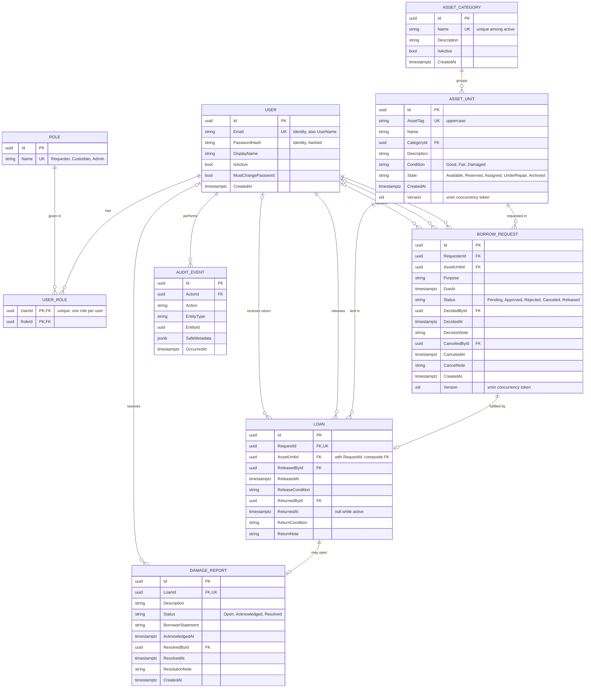

# SitesLend: Entity Relationship Diagram and Data Dictionary

| Item | Detail |
|---|---|
| Project | GT-OJT-01, IT Asset Borrowing and Inventory System |
| Version | ERD v2, 26 November 2026 (replaces the v1 diagram from 24 November) |
| Status | Draft for mentor review (task A08) |
| Database | PostgreSQL, schema managed by EF Core migrations (Npgsql) |
| Sources | BRD/PRD v1.0, OJT task sheet A01 to A21, team decisions BR-02 (changed) and BR-09 to BR-13 |

## 1. Scope

**Covered by this model**
- Login accounts and roles (Requester, Custodian, Admin)
- Asset categories and individually tagged physical units, with condition and state
- Borrow requests from submission to decision, cancel and release
- Loans from release to return, with condition recorded at both ends
- Damage reports that hold the last borrower accountable
- An append only audit trail of every stock affecting action

**Not stored in the database**
- Overdue status, availability counts, category quantities and dashboard numbers. These are computed by queries (see section 8).
- The 7 day loan limit and other settings. These live in `appsettings.json`.
- Login sessions. Cookie authentication keeps the session in an encrypted cookie.

**Out of scope (BRD section 4)**: purchasing, depreciation, barcode hardware, email or SMS, multi branch transfers, repair service desk, consumables, HR integration, payments or charges.

## 2. What changed from v1 and why

| # | Change | Reason |
|---|---|---|
| 1 | Removed `Loan.BorrowerId` | Redundant. The borrower is always the request's `RequesterId`. |
| 2 | Removed `DamageReport.AssetUnitId`, `BorrowerId`, `ReportedById` and `ReportedAt` | Redundant. All four can be reached through `LoanId`. The report is created at return, so the reporter and time are the loan's `ReturnedById` and `ReturnedAt`. `CreatedAt` is kept for sorting. |
| 3 | Request status now ends at **Released**. "Returned" is no longer a request status. | Redundant. A returned request is exactly "Released and its loan has `ReturnedAt`". Storing it twice could let the two disagree. The screen still shows "Returned" as a display status (section 8). |
| 4 | `Loan.AssetUnitId` kept, now protected by a composite foreign key `(RequestId, AssetUnitId)` to `BorrowRequests(Id, AssetUnitId)` | The one active loan per unit rule needs the unit id on the loan row. The composite key makes it impossible for the copy to disagree with the request. |
| 5 | `User.Role` replaced by Identity's `Roles` and `UserRoles` tables, plus a unique index on `UserRoles(UserId)` | Accurate to ASP.NET Core Identity. The unique index enforces one role per user now, and can be dropped later if a user ever needs two roles. |
| 6 | Added `AssetUnit.Name` (required) | v1 had only an optional Description, so the list could show blank rows. Name is what people search for, such as "Dell Latitude 5440". |
| 7 | Renamed `CancelReason` to `CancelNote` | Same style as `DecisionNote`. Who canceled (requester or custodian) is already known from `CanceledById`, so no separate reason code is needed. |
| 8 | Renamed `AuditEvent.Timestamp` to `OccurredAt` | `Timestamp` is a reserved word in some tools and says less. |
| 9 | Added CHECK constraints and partial unique indexes (section 6) | Business rules that the database itself can guarantee, so a bug or a double click cannot break them. |
| 10 | Added unit move **Available to Under Repair** (custodian marks for repair) | A custodian may find a fault during inspection, not only at return. |
| 11 | Explicitly no `Quantity` column | Each row is one physical unit (BR-01). Quantity per category is a count of rows, so stock can never go negative. |

## 3. Diagram

## 4. Relationships and cardinality

Read each row as "one [left] has [cardinality] [right]".

| Left | Right | Cardinality | Foreign key | Notes |
|---|---|---|---|---|
| User | UserRole | 1 to exactly 1 (MVP) | `UserRoles.UserId` | Unique index on `UserId` enforces one role. Drop it to allow several. |
| Role | UserRole | 1 to 0 or many | `UserRoles.RoleId` | |
| AssetCategory | AssetUnit | 1 to 0 or many | `AssetUnits.CategoryId` | Every unit has exactly one category. |
| AssetUnit | BorrowRequest | 1 to 0 or many | `BorrowRequests.AssetUnitId` | At most **one Approved** request per unit at a time. |
| User (requester) | BorrowRequest | 1 to 0 or many | `BorrowRequests.RequesterId` | |
| User (decider) | BorrowRequest | 0 or 1 to 0 or many | `BorrowRequests.DecidedById` | Null while Pending. Never equal to `RequesterId`. |
| User (canceler) | BorrowRequest | 0 or 1 to 0 or many | `BorrowRequests.CanceledById` | Null unless Canceled. |
| BorrowRequest | Loan | 1 to 0 or 1 | `Loans.RequestId` (unique) | A loan exists only after release. |
| AssetUnit | Loan | 1 to 0 or many | `Loans.AssetUnitId` | At most **one active** loan per unit at a time. |
| User (releaser) | Loan | 1 to 0 or many | `Loans.ReleasedById` | |
| User (receiver) | Loan | 0 or 1 to 0 or many | `Loans.ReturnedById` | Null while the loan is active. |
| Loan | DamageReport | 1 to 0 or 1 | `DamageReports.LoanId` (unique) | Created only when a return is marked Damaged. |
| User (resolver) | DamageReport | 0 or 1 to 0 or many | `DamageReports.ResolvedById` | Null until Resolved. |
| User (actor) | AuditEvent | 1 to 0 or many | `AuditEvents.ActorId` | |

**Delete rule for every foreign key:** `ON DELETE RESTRICT`. Nothing with history is ever hard deleted (BR-07), so cascades are never needed.

## 5. Data dictionary

Conventions for every table:
- Primary keys are `uuid`, generated by the app as UUID version 7 (`Guid.CreateVersion7()`), which sorts by time and keeps indexes efficient.
- All times are `timestamptz`, stored in UTC and shown in Philippine time (UTC+8).
- Enum values are stored as text, such as `'Available'`, so the data stays readable.
- Text limits below are enforced by the API (validation) and the database (column length).

### 5.1 Users (ASP.NET Core Identity `AspNetUsers`, extended)

| Column | Type | Null | Key | Rule or meaning |
|---|---|---|---|---|
| Id | uuid | No | PK | |
| Email | varchar(256) | No | UQ (normalized) | Also used as UserName for login. Synthetic addresses only, such as `requester1@siteslend.test`. |
| PasswordHash | text | No | | Hashed by Identity. Never plain text. |
| DisplayName | varchar(100) | No | | Shown in lists and history. |
| IsActive | boolean | No | | False blocks login. Accounts are deactivated, never deleted. |
| MustChangePassword | boolean | No | | True after the admin sets a temporary password (BR-12). |
| CreatedAt | timestamptz | No | | |

Identity also adds its own columns (`NormalizedEmail`, `SecurityStamp`, `ConcurrencyStamp`, `LockoutEnd`, `AccessFailedCount` and others). Use Identity lockout to slow down password guessing. Leave `PhoneNumber` empty to keep personal data minimal (NFR-02).

### 5.2 Roles and UserRoles (Identity `AspNetRoles`, `AspNetUserRoles`)

| Table | Column | Type | Null | Key | Rule or meaning |
|---|---|---|---|---|---|
| Roles | Id | uuid | No | PK | |
| Roles | Name | varchar(50) | No | UQ | Seeded: Requester, Custodian, Admin. |
| UserRoles | UserId | uuid | No | PK, FK, UQ | UQ means one role per user in the MVP. |
| UserRoles | RoleId | uuid | No | PK, FK | |

### 5.3 AssetCategories

| Column | Type | Null | Key | Rule or meaning |
|---|---|---|---|---|
| Id | uuid | No | PK | |
| Name | varchar(100) | No | UQ among active | Unique (ignoring case) among active categories, per the BRD. |
| Description | varchar(500) | Yes | | |
| IsActive | boolean | No | | False hides it when adding new units. Existing units are not affected. |
| CreatedAt | timestamptz | No | | |

### 5.4 AssetUnits

| Column | Type | Null | Key | Rule or meaning |
|---|---|---|---|---|
| Id | uuid | No | PK | |
| AssetTag | varchar(30) | No | UQ | Stored in uppercase. Letters, digits and hyphens, 3 to 30 characters, such as `LAP-0001`. Never changes once a unit has history. |
| Name | varchar(120) | No | | Short name, such as "Dell Latitude 5440". |
| CategoryId | uuid | No | FK | Category must be active when the unit is created. |
| Description | varchar(500) | Yes | | Extra notes such as serial number or accessories. |
| Condition | varchar(20) | No | | `Good`, `Fair`, `Damaged`. Current condition. |
| State | varchar(20) | No | | `Available`, `Reserved`, `Assigned`, `UnderRepair`, `Archived` (section 7). |
| CreatedAt | timestamptz | No | | |
| Version | xid (system column `xmin`) | No | | Concurrency token. Not created by the migration; PostgreSQL provides it. |

### 5.5 BorrowRequests

| Column | Type | Null | Key | Rule or meaning |
|---|---|---|---|---|
| Id | uuid | No | PK, UQ with AssetUnitId | `(Id, AssetUnitId)` is an alternate key so Loans can reference both. |
| RequesterId | uuid | No | FK Users | Set by the server from the session, never from the request body. |
| AssetUnitId | uuid | No | FK AssetUnits | One unit per request in the MVP. |
| Purpose | varchar(500) | No | | |
| DueAt | timestamptz | No | | The chosen date at 5:00 PM Philippine time. Must be after `CreatedAt` and no more than 7 days ahead (setting `MaxLoanDays`). |
| Status | varchar(20) | No | | `Pending`, `Approved`, `Rejected`, `Canceled`, `Released` (section 7). |
| DecidedById | uuid | Yes | FK Users | Custodian or admin who approved or rejected. Never the requester. |
| DecidedAt | timestamptz | Yes | | |
| DecisionNote | varchar(1000) | Yes | | Required when Rejected. |
| CanceledById | uuid | Yes | FK Users | The requester, or a custodian marking "not picked up". |
| CanceledAt | timestamptz | Yes | | |
| CancelNote | varchar(1000) | Yes | | |
| CreatedAt | timestamptz | No | | When the request was submitted. |
| Version | xid (`xmin`) | No | | Concurrency token. |

### 5.6 Loans

| Column | Type | Null | Key | Rule or meaning |
|---|---|---|---|---|
| Id | uuid | No | PK | |
| RequestId | uuid | No | FK, UQ | One loan per request. |
| AssetUnitId | uuid | No | FK | Must match the request's unit (composite FK). Needed for the one active loan rule. |
| ReleasedById | uuid | No | FK Users | Custodian or admin. |
| ReleasedAt | timestamptz | No | | |
| ReleaseCondition | varchar(20) | No | | `Good` or `Fair`. A Damaged unit cannot be released. |
| ReturnedById | uuid | Yes | FK Users | |
| ReturnedAt | timestamptz | Yes | | Null means the loan is active. |
| ReturnCondition | varchar(20) | Yes | | `Good`, `Fair` or `Damaged`. |
| ReturnNote | varchar(1000) | Yes | | |

### 5.7 DamageReports

| Column | Type | Null | Key | Rule or meaning |
|---|---|---|---|---|
| Id | uuid | No | PK | |
| LoanId | uuid | No | FK, UQ | One report per loan. Borrower and unit are reached through the loan. |
| Description | varchar(1000) | No | | What is damaged, written by the custodian at return. |
| Status | varchar(20) | No | | `Open`, `Acknowledged`, `Resolved`. |
| BorrowerStatement | varchar(1000) | Yes | | Written by the borrower when acknowledging. |
| AcknowledgedAt | timestamptz | Yes | | |
| ResolvedById | uuid | Yes | FK Users | Custodian or admin. |
| ResolvedAt | timestamptz | Yes | | |
| ResolutionNote | varchar(1000) | Yes | | How it was settled outside the system. No money amounts (accounting is out of scope). |
| CreatedAt | timestamptz | No | | Same moment as the loan's `ReturnedAt`. |

### 5.8 AuditEvents

| Column | Type | Null | Key | Rule or meaning |
|---|---|---|---|---|
| Id | uuid | No | PK | |
| ActorId | uuid | No | FK Users | Always from the session, never from the request. |
| Action | varchar(50) | No | | One of the actions in section 7.4. |
| EntityType | varchar(50) | No | | `AssetUnit`, `AssetCategory`, `BorrowRequest`, `Loan`, `DamageReport`, `User`. |
| EntityId | uuid | No | | No foreign key, because it can point to any table. |
| SafeMetadata | jsonb | Yes | | Small details, such as `{"from":"Pending","to":"Approved"}`. Never passwords, tokens or full request bodies. |
| OccurredAt | timestamptz | No | | |

## 6. Constraints and indexes the database enforces

### 6.1 Unique and partial unique indexes

| Table | Index | Protects |
|---|---|---|
| AssetUnits | UQ `upper(AssetTag)` | BR-01: one tag per physical unit |
| AssetCategories | UQ `lower(Name)` WHERE `IsActive` | Unique category names among active ones |
| BorrowRequests | UQ `(AssetUnitId)` WHERE `Status = 'Approved'` | BR-09: only one reservation per unit |
| BorrowRequests | UQ `(RequesterId, AssetUnitId)` WHERE `Status IN ('Pending','Approved')` | FR-12: no duplicate open request for the same unit |
| BorrowRequests | UQ `(Id, AssetUnitId)` | Target of the composite FK from Loans |
| Loans | UQ `(RequestId)` | One loan per request, so no double release |
| Loans | UQ `(AssetUnitId)` WHERE `ReturnedAt IS NULL` | BR-04, BR-05: one active borrower per unit |
| DamageReports | UQ `(LoanId)` | One report per loan |
| UserRoles | UQ `(UserId)` | One role per user (MVP) |

### 6.2 CHECK constraints

| Table | Check | Protects |
|---|---|---|
| AssetUnits | `Condition IN ('Good','Fair','Damaged')` and `State IN (...)` | Valid values only |
| BorrowRequests | `DecidedById IS NULL OR DecidedById <> RequesterId` | BR-03: no self approval, even if the code has a bug |
| BorrowRequests | `DueAt > CreatedAt` | Due date in the future |
| BorrowRequests | Status `Approved`, `Rejected` or `Released` requires `DecidedById` and `DecidedAt` | Every decision has an owner and a time |
| BorrowRequests | Status `Rejected` requires `DecisionNote` | Reject needs a reason |
| BorrowRequests | Status `Canceled` requires `CanceledById` and `CanceledAt` | Every cancel has an owner and a time |
| Loans | `ReturnedAt`, `ReturnedById` and `ReturnCondition` are all null or all filled | A return is complete or not at all (BR-05) |
| Loans | `ReturnedAt IS NULL OR ReturnedAt >= ReleasedAt` | Time order |
| Loans | `ReleaseCondition IN ('Good','Fair')` | A Damaged unit is never released |
| DamageReports | Status `Acknowledged` requires `AcknowledgedAt` | |
| DamageReports | Status `Resolved` requires `ResolvedById`, `ResolvedAt` and `ResolutionNote` | Every resolution is explained |

### 6.3 Other indexes (for speed)

`AssetUnits(CategoryId)`, `AssetUnits(State)`, `BorrowRequests(RequesterId, Status)`, `BorrowRequests(AssetUnitId, Status)`, `Loans(ReturnedAt)`, `DamageReports(Status)`, `AuditEvents(EntityType, EntityId)`, `AuditEvents(OccurredAt)`, `AuditEvents(ActorId)`.

### 6.4 Audit protection

The API has no update or delete endpoint for audit events. As an extra layer (a Should for A19), add a trigger that raises an error on any `UPDATE` or `DELETE` of `AuditEvents`.

## 7. Status values and allowed moves

### 7.1 BorrowRequest.Status

| From | Action | Who | To | Unit State becomes |
|---|---|---|---|---|
| (new) | Submit | Requester (own) | Pending | No change (must be Available) |
| Pending | Approve | Custodian or Admin, not the requester | Approved | Reserved |
| Pending | Reject (note required) | Custodian or Admin, not the requester | Rejected | No change |
| Pending | Cancel | Requester (own) | Canceled | No change |
| Approved | Cancel | Requester (own) | Canceled | Available |
| Approved | Mark not picked up | Custodian or Admin | Canceled | Available |
| Approved | Release (record condition) | Custodian or Admin | Released | Assigned |

Rejected, Canceled and Released are final for the request. After release, the **loan** carries the story.

### 7.2 AssetUnit.State

| From | Event | To | Condition becomes |
|---|---|---|---|
| Available | Request approved | Reserved | No change |
| Reserved | Request canceled or not picked up | Available | No change |
| Reserved | Released | Assigned | ReleaseCondition |
| Assigned | Returned Good or Fair | Available | ReturnCondition |
| Assigned | Returned Damaged | UnderRepair | Damaged |
| Available | Custodian marks for repair | UnderRepair | Damaged |
| UnderRepair | Custodian marks repaired | Available | Good or Fair |
| Available or UnderRepair | Archive (no Pending or Approved requests) | Archived | No change |

Archived is final. Archived units stay in the database with their full history.

### 7.3 DamageReport.Status

| From | Action | Who | To |
|---|---|---|---|
| (new) | Return marked Damaged | System, during return | Open |
| Open | Acknowledge, with optional statement | Borrower | Acknowledged |
| Open or Acknowledged | Resolve, with required note | Custodian or Admin | Resolved |

### 7.4 AuditEvent.Action values

`UserCreated`, `UserRoleChanged`, `UserDeactivated`, `PasswordReset`, `CategoryCreated`, `CategoryUpdated`, `AssetCreated`, `AssetUpdated`, `AssetStateChanged`, `AssetArchived`, `RequestSubmitted`, `RequestApproved`, `RequestRejected`, `RequestCanceled`, `LoanReleased`, `LoanReturned`, `DamageReported`, `DamageAcknowledged`, `DamageResolved`.

## 8. Derived values (computed, never stored)

| Value | How it is computed |
|---|---|
| Active loan | `Loans.ReturnedAt IS NULL` |
| Overdue (BR-06) | Active loan and `now() > BorrowRequests.DueAt` |
| Display status on "My requests" | Request status, except a Released request shows **Active**, **Overdue** or **Returned** from its loan |
| Borrower of a loan | `BorrowRequests.RequesterId` through `Loans.RequestId` |
| Category quantity | `COUNT(*)` of its units that are not Archived |
| Available count | Units where `State = 'Available'` |
| Requester is blocked | Has a DamageReport (through Loan and Request) with `Status <> 'Resolved'` |
| Dashboard counts (FR-08) | Available units, Pending requests, active loans, overdue loans, each filtered by role |

## 9. Intentional duplicates and how they stay correct

A fully normalized model would not store these. They are kept on purpose, and each has a guard.

| Duplicate | Why it is kept | Guard |
|---|---|---|
| `AssetUnits.State` (Reserved and Assigned can be worked out from requests and loans) | Needed anyway for Available, UnderRepair and Archived. It gives a fast availability filter, and it is the row that the concurrency token locks during approve and release. | Changed only by the workflow service, in the same transaction as the request or loan. Partial unique indexes catch any mistake. |
| `Loans.AssetUnitId` (also on the request) | Needed for the one active loan per unit index. | Composite FK `(RequestId, AssetUnitId)` to `BorrowRequests(Id, AssetUnitId)`. |
| `AssetUnits.Condition` vs `Loans.ReleaseCondition` and `ReturnCondition` | Not really a duplicate: the unit keeps the current value, and the loan keeps a snapshot from that moment. The snapshots prove when damage happened. | None needed. |

## 10. Business rules: where each one is enforced

| Rule | Database | API service |
|---|---|---|
| BR-01 one unique tag per unit, counts derived | UQ AssetTag, no quantity column | Validates tag format |
| BR-02 requester cancels own Pending or Approved request | CHECK cancel fields | Ownership and status check |
| BR-03 no self approval, custodian or admin only | CHECK `DecidedById <> RequesterId` | Role policy and check |
| BR-04 only approved and available units are released, no double release | UQ `Loans(RequestId)`, UQ active loan per unit | Transaction, status check, concurrency token |
| BR-05 one active borrower, return happens once with condition and time | UQ active loan, CHECK return fields | Transaction, status check |
| BR-06 overdue is derived | Not stored | Computed in queries |
| BR-07 archive, never hard delete | `ON DELETE RESTRICT` everywhere | No delete endpoints |
| BR-08 auditable changes, audit not editable | Trigger (Should) | Audit writer in the same transaction, no edit endpoints |
| BR-09 approval reserves the unit, "not picked up" cancel | UQ one Approved request per unit | Sets State, allows custodian cancel |
| BR-10 condition at release and return, damage report, borrower blocked | CHECK release condition, UQ report per loan | Creates report on Damaged return, blocks new requests |
| BR-11 maximum 7 day loan | CHECK `DueAt > CreatedAt` | Checks `MaxLoanDays` setting |
| BR-12 admin creates accounts | | Admin only endpoint, MustChangePassword |
| BR-13 print and CSV scoped, CSV escaped | | Same filters as lists, formula escaping |
| FR-12 no duplicate open request | UQ open request per requester and unit | Returns 409 |

## 11. Scenario walkthrough

Synthetic users: **Requester One** (`requester1@siteslend.test`), **Custodian One** (`custodian1@siteslend.test`). Unit: `LAP-0003`, "Dell Latitude 5440", Available, Good.

| Step | Action | Rows written | Request | Loan | Unit State, Condition |
|---|---|---|---|---|---|
| 1 | Requester One submits, due in 5 days | BorrowRequest, AuditEvent `RequestSubmitted` | Pending | none | Available, Good |
| 2 | Custodian One approves | BorrowRequest updated, AssetUnit updated, AuditEvent `RequestApproved` | Approved | none | Reserved, Good |
| 3 | Custodian One releases, condition Good | Loan created, BorrowRequest and AssetUnit updated, AuditEvent `LoanReleased` | Released | Active | Assigned, Good |
| 4 | Due date passes with no return | Nothing written | Released (shows Overdue) | Active | Assigned, Good |
| 5 | Custodian One records return as Damaged, "cracked screen" | Loan updated, DamageReport created, AssetUnit updated, AuditEvents `LoanReturned` and `DamageReported` | Released (shows Returned) | Returned | UnderRepair, Damaged |
| 6 | Requester One tries a new request | Nothing written, API returns 409 | | | |
| 7 | Requester One acknowledges with a statement | DamageReport updated, AuditEvent `DamageAcknowledged` | | | |
| 8 | Custodian One resolves, "settled per company policy" | DamageReport updated, AuditEvent `DamageResolved` | | | Requester One can borrow again |
| 9 | Custodian One marks the unit repaired, condition Fair | AssetUnit updated, AuditEvent `AssetStateChanged` | | | Available, Fair |

### 11.1 Blocked attempts (each maps to a negative test)

| Attempt | Stopped by | Response |
|---|---|---|
| Requester approves their own request | Role policy, then CHECK constraint | 403 |
| Second request approved for a Reserved unit | Service check, UQ one Approved per unit | 409 |
| Two custodians release the same request at once | Concurrency token, UQ `Loans(RequestId)` | 409 for the second |
| Return recorded twice | Service status check, CHECK return fields | 409 |
| Requester submits the same unit twice | UQ open request per requester and unit | 409 |
| Requester B opens Requester A's request by id | Ownership check | 403, no data in the body |
| Release a unit marked Damaged | Service check, CHECK `ReleaseCondition` | 409 |
| Archive a unit with a Pending request | Service check | 409 |
| Edit or delete an audit event | No endpoint, trigger | 404 or 405, error from the database |

## 12. Ready for future changes

| Possible change | What to add | Existing data affected? |
|---|---|---|
| Several units in one request | `BorrowRequestItems` table between requests and units; move `AssetUnitId` there | Move one column into the new table |
| A different loan limit per category | Nullable `AssetCategories.MaxLoanDays` | No |
| Lost items | `Type` column on DamageReports (`Damaged`, `Lost`) | No, default `Damaged` |
| Charges or payments | `DamageSettlements` table linked to DamageReports | No |
| Multiple offices or branches | `Locations` table and `AssetUnits.LocationId` | No, one default location |
| A user with two roles | Drop the unique index on `UserRoles(UserId)` | No |
| New role, such as Auditor | Insert a row in Roles, add a policy | No |
| Booking ahead for a future date | `StartAt` column on BorrowRequests | No |
| Brand, model or serial number fields | Columns on AssetUnits, or an `AssetModels` table | No |
| In app notifications | `Notifications` table linked to Users | No |

## 13. Items needing mentor confirmation

1. Request status ends at **Released**, and "Returned" becomes a display status worked out from the loan (change 3).
2. New required field `AssetUnit.Name` (change 6).
3. New move **Available to Under Repair** by a custodian (change 10).
4. A unit can be archived only when it has no Pending or Approved requests.
5. Roles stored in Identity's tables with one role per user enforced by a unique index (change 5).
6. Business rule changes BR-02 and BR-09 to BR-13 from 24 November.
